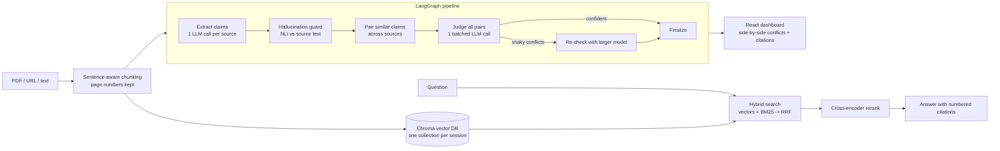

# ReasonIX

Upload PDFs, URLs or text, and ReasonIX finds where your sources **agree and where they genuinely contradict each other**,
showing the conflicting claims side by side with page-level citations.

**Live demo:** _add your link after deployment_

## How it works



- **Claim-level contradiction detection:** sources are turned into atomic claims; only claims about the same topic are compared; each pair is labeled contradiction / agreement / neutral with a confidence and a reason.
- **Hallucination guard:** every extracted claim is checked against the passage it came from with an NLI model; claims the source does not support are dropped before they can create a fake contradiction.
- **Claim graph:** claims as nodes (one column per source), contradicts / supports links as edges.
- **Web verification:** one click checks a claim against live web search results (supported / contradicted / unverified) and lists the sources; a verdict that cites no source is downgraded to unverified.
- **Second opinion:** low-confidence contradictions are re-judged by a larger model (conditional edge in the LangGraph pipeline).
- **Citations:** every claim and answer links to its source passage and PDF page; quoted evidence is checked against the passage.
- **Retrieval:** hybrid BM25 + vector search, reciprocal rank fusion, cross-encoder reranking.
- **Engineering:** per-session storage, persistent Chroma, background analysis with polling (upload answers in ~2 s), URL/SSRF protection, upload limits, restricted CORS, pytest suite, Docker, GitHub Actions CI, optional Langfuse tracing.

## Results

> Run the commands below and paste your own numbers here. Do not quote numbers you have not run.

Contradiction judge (`python -m evaluation.run_eval`), 45 hand-labeled pairs:

| Judge | Accuracy | Macro-F1 |
|---|---|---|
| _paste from evaluation/results_pairs.md_ | | |

Retrieval (`python -m evaluation.retrieval_eval`), 12 docs / 24 questions:

| Mode | Hit@1 | MRR |
|---|---|---|
| _paste from evaluation/results_retrieval.md_ | | |

## Run it

```bash
cp .env.example .env            # add GROQ_API_KEY
pip install -r requirements.txt -r requirements-extras.txt
uvicorn main:app                # backend  http://localhost:8000
cd FrontWork/frontend && npm install && npm run dev   # frontend http://localhost:5173
```

Or: `docker compose up --build`.  Tests: `pip install -r requirements-dev.txt && pytest`.

## Stack
FastAPI, React + Vite + Tailwind, Groq (gpt-oss), LangChain (structured output), LangGraph, Chroma, sentence-transformers (embeddings + cross-encoder reranker), PyMuPDF, BeautifulSoup, Langfuse (optional), Docker, GitHub Actions.
