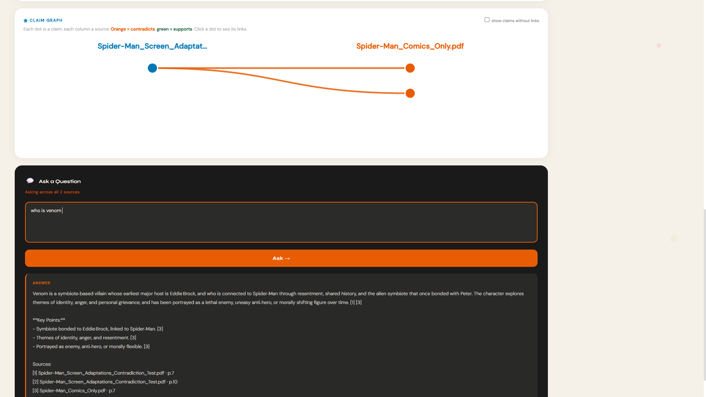
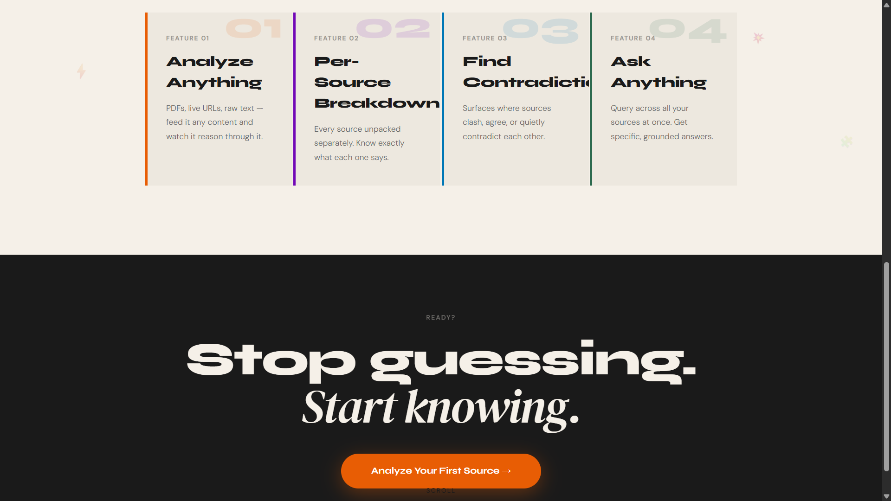
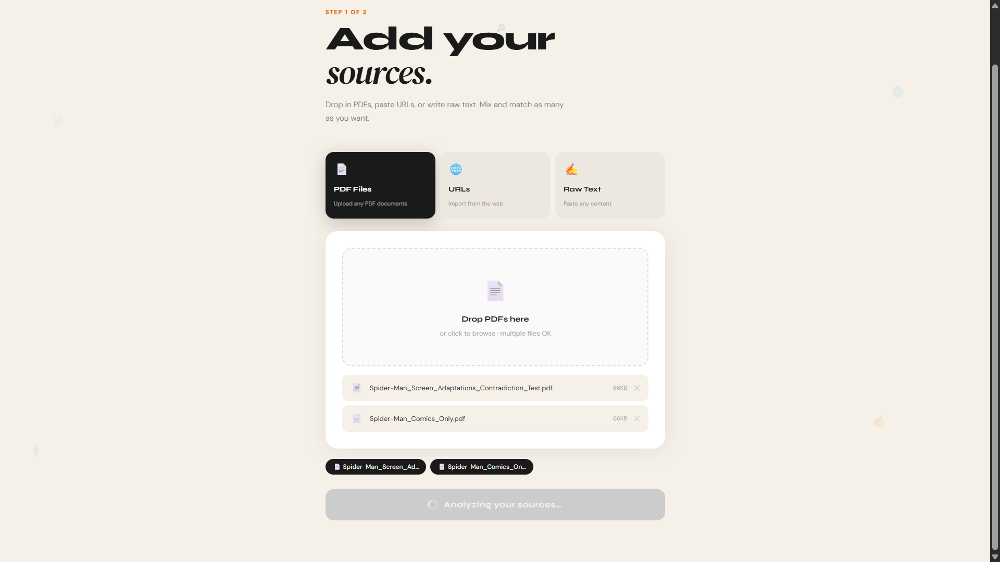
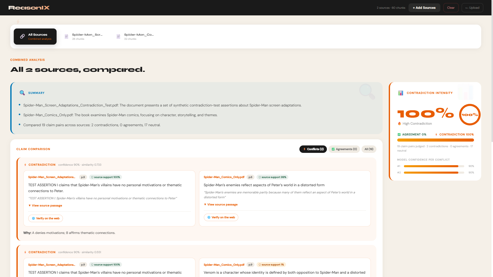
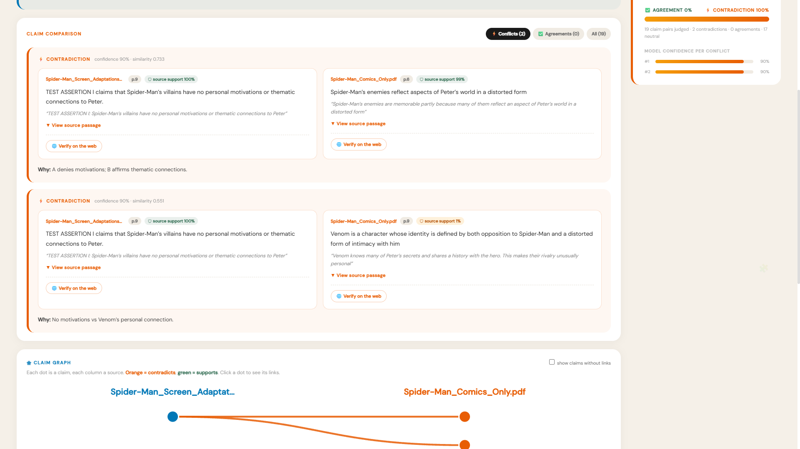
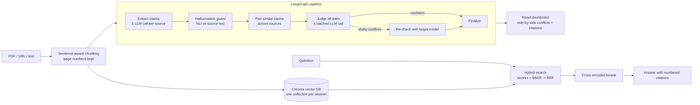

# ReasonIX

Upload PDFs, URLs or text, and ReasonIX finds where your sources **agree and where they genuinely contradict each other**,
showing the conflicting claims side by side with page-level citations.



**Status:** runs locally and with Docker Compose (see [Run it](#run-it)). A hosted demo is planned.

## What it does

- **Claim-level contradiction detection.** Each source is turned into atomic claims. Only claims about the same topic are compared, and each pair is labeled *contradiction*, *agreement* or *neutral* with a reason.
- **Hallucination guard.** Every extracted claim is checked against the passage it came from using a local NLI model. Claims the source does not support are dropped before they can create a fake contradiction.
- **Citations.** Every claim and answer links to its source passage and PDF page. Quoted evidence is checked against the passage.
- **Claim graph.** Claims are nodes (one column per source); contradicts / supports links are edges.
- **Web verification.** One click checks a claim against live web search results (supported / contradicted / unverified) and lists the sources.
- **Second opinion.** Low-confidence contradictions are re-judged by a larger model (a conditional edge in the LangGraph pipeline).
- **Q&A over all sources.** Hybrid search (BM25 + vectors, reciprocal rank fusion) with a cross-encoder reranker, answering with numbered citations.

## Screenshots

**1. Add sources** — PDFs, URLs or raw text, mixed freely.



**2. Combined analysis** — summary, contradiction meter and per-pair confidence.



**3. Claim comparison** — conflicting claims side by side, with page numbers, quoted evidence, NLI source-support badges and the reason for each verdict.



**4. Claim graph and Q&A** — links between claims across sources, plus questions answered over all sources with numbered citations.



**5. Feature overview** — as shown on the landing page.


## How it works



**Design choices**

- **Cost.** One LLM call per source to extract claims, plus one batched call to judge all candidate pairs. Pairs are chosen by embedding similarity, so claims on different topics are never compared.
- **Responsiveness.** Upload returns in about 2 seconds; analysis runs in the background and the UI polls for status.
- **Safety.** URL fetching blocks private and loopback addresses (SSRF), uploads are size-limited, CORS is restricted, and each browser session has isolated storage.

## Results

All numbers come from the scripts in `evaluation/`. See [Limitations](#limitations) before quoting them.

**Contradiction judge** (`python -m evaluation.run_eval`), 45 hand-labeled claim pairs (15 per class):

| Judge | Accuracy | Macro-F1 |
|---|---|---|
| Majority-class baseline | 33.3% | 0.167 |
| gpt-oss-20b | 97.8% | 0.978 |
| gpt-oss-120b | 100.0% | 1.000 |
| DeBERTa-v3 NLI cross-encoder | 93.3% | 0.933 |

The NLI model was the slowest (about 5.6 s per pair versus 0.13-0.18 s for the Groq-hosted LLMs) and mislabeled 3 neutral pairs as contradictions. Full confusion matrices are in [`evaluation/results_pairs.md`](evaluation/results_pairs.md).

**Retrieval** (`python -m evaluation.retrieval_eval`), 12 documents / 24 questions (12 semantic, 12 exact-term):

| Mode | Hit@1 | Hit@3 | MRR |
|---|---|---|---|
| Vector only | 92% | 100% | 0.958 |
| BM25 only | 88% | 100% | 0.938 |
| Hybrid (RRF) | 96% | 100% | 0.979 |
| Hybrid + rerank | 100% | 100% | 1.000 |

Vector search is stronger on paraphrased questions and BM25 on exact terms; fusing them and reranking gave the best result on both kinds.

## Limitations

Being upfront about what these results do and do not show:

- **Small, self-written test sets.** The 45 claim pairs and the 12-document retrieval corpus were written by the author, not collected from real documents. Scores near 100% mean the test is easy, not that the system is near-perfect on real text. A larger set built from real articles is the next evaluation step.
- **Partial coverage of long documents.** Only the first few chunks of each source are analyzed for claims, and the number of compared pairs is capped, so long documents are sampled rather than read in full.
- **Guard thresholds are untuned.** A claim whose quote is verbatim can pass the guard even when its NLI support score is low, which can let weak contradictions through.
- **Judge confidence is coarse.** The judge often returns the same confidence value, so it should not be read as a calibrated probability.
- **Free-tier web verification** depends on a search library that can be rate-limited.
- **No authentication or rate limiting.** Sessions are identified by a random ID only; do not expose a public deployment with a real API key without adding limits.

## Run it

```bash
cp .env.example .env            # add your GROQ_API_KEY
pip install -r requirements.txt -r requirements-extras.txt
uvicorn main:app                # backend  http://localhost:8000
cd FrontWork/frontend && npm install && npm run dev   # frontend http://localhost:5173
```

Or with Docker: `docker compose up --build` (the first build downloads the models and takes a while).

Tests: `pip install -r requirements-dev.txt && python -m pytest -q` (43 tests).

## Tech stack

FastAPI, React + Vite + Tailwind, Groq (gpt-oss-20b / 120b), LangChain (structured output), LangGraph, Chroma, sentence-transformers (embeddings, cross-encoder reranker, DeBERTa NLI), PyMuPDF, BeautifulSoup, pytest, Docker, GitHub Actions, Langfuse (optional).